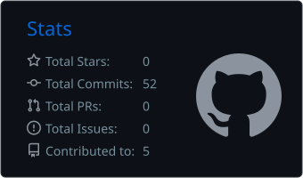
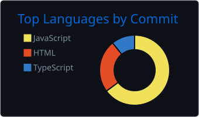

 **Skills**

### Dev Tools:

 ***About me***

I'm a Computer Science undergraduate at **VIT Chennai** (B.Tech CSE, 2026–2030). I build full-stack apps, AI tools and voice agents — and I don't vibe code them. Three projects shipped so far, many more to come.

- 🧙‍♂️ I'm currently learning ...
  * *Data Structures & Algorithms*
  * *C++*
  * *Cybersecurity*
- 🏆 Certifications: *AI Fundamentals (IBM)* · *SQL Basic (HackerRank)*
- 👻 Reach out to me at: <pranavkaushik213@gmail.com>

## 🚀 Featured Projects

| Project | What it is | Stack | Links |
| --- | --- | --- | --- |
| **GDG Recruitment Portal** | Rebuilt recruitment portal for GDG on Campus VIT Chennai across 12 departments. Google OAuth, atomic submissions, protected admin review desk, and a fix for a hidden bug that was silently discarding applicants' answers. | Next.js · React · Firestore · Zod | [Live](https://gdg-portal-phi.vercel.app/) · [Code](https://github.com/Pranavcodes24x7/GDG---Recruitment-Portal) |
| **AI Recruiter** | Candidate-analysis workspace that extracts skills from conversational input, matches profiles to job roles with category-weighted scoring, and speaks results back. Runs fully client-side — no LLM API key. | JavaScript · Python | [Code](https://github.com/Pranavcodes24x7/AI-Recruiter) |
| **JARVIS** | My own voice agent, built in a 2-day college workshop. Real-time voice, camera and screen sharing, and live audio visualizers. | Next.js · TypeScript · LiveKit | [Live](https://jarvis-nine-psi-79.vercel.app/) · [Code](https://github.com/Pranavcodes24x7/jarvis) |
| **Personal Portfolio** | My first project — a dependency-free portfolio site, deployed on Vercel. | HTML · CSS · JavaScript | [Live](https://pranav-portfolio-one-indol.vercel.app/) · [Code](https://github.com/Pranavcodes24x7/pranav-portfolio) |

